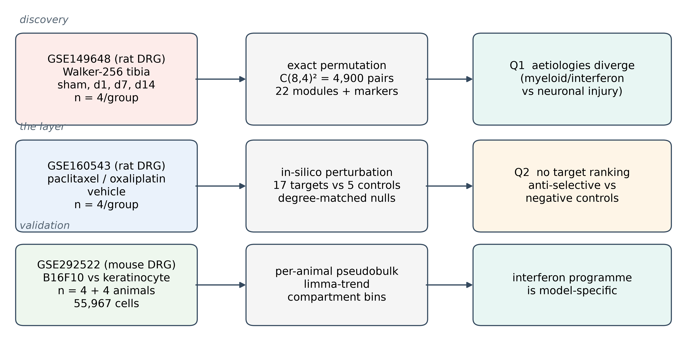
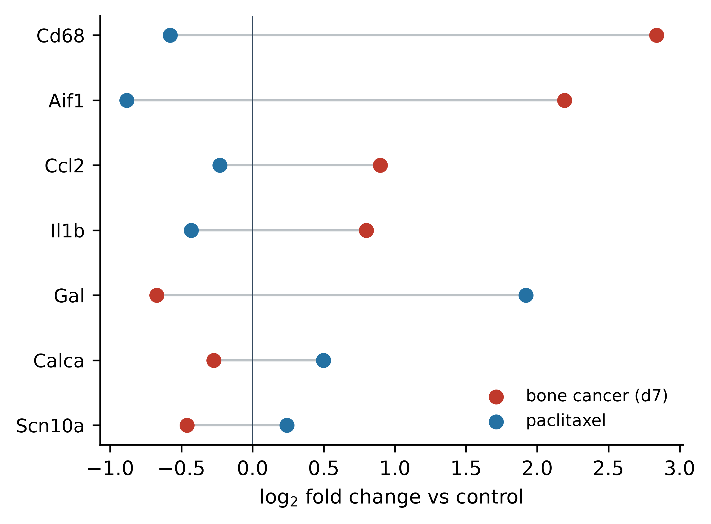
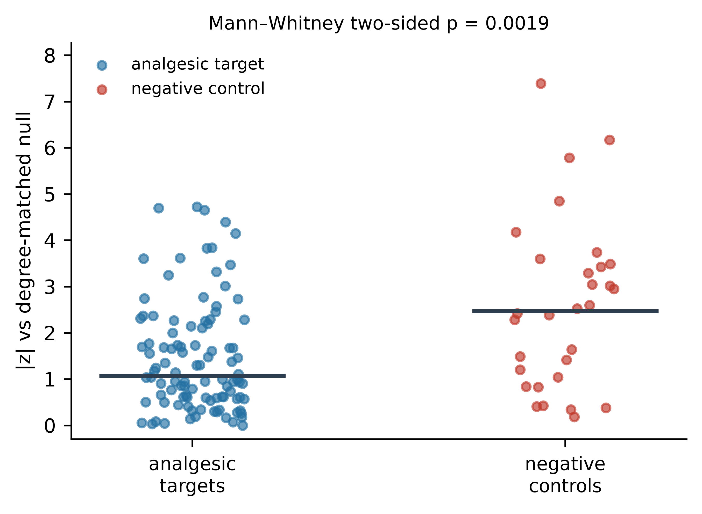

# Divergent dorsal root ganglion programs in bone cancer pain and chemotherapy-induced peripheral neuropathy: an exact cross-study reanalysis and a negative-control calibration of in-silico perturbation

**Running head:** Divergent DRG programs: bone cancer pain vs CIPN

**Author:** Yongxin Yang¹

¹ Department of Anesthesiology, The Second Affiliated Hospital of Fujian University of Traditional Chinese Medicine, Fuzhou, Fujian 350003, China

**ORCID:** 0009-0004-9698-6552

**Correspondence:** Yongxin Yang, Department of Anesthesiology, The Second Affiliated Hospital of Fujian University of Traditional Chinese Medicine, Fuzhou, Fujian 350003, China. Email: 960856791@qq.com

---

## Abstract

**Background.** Bone cancer pain and chemotherapy-induced peripheral neuropathy (CIPN) are managed as one entity, yet their sensory-neuron biology is assumed to differ. Two questions are conflated: whether the dorsal root ganglion (DRG) programs diverge, and whether in-silico perturbation of bulk transcriptomes can rank analgesic targets.

**Methods.** We reanalysed rat DRG RNA-seq from two same-platform studies (GSE149648, tibial Walker-256 bone cancer pain, sham and days 1/7/14; GSE160543, paclitaxel/oxaliplatin neuropathy; n = 4 per group). Differential expression used empirical-Bayes moderated *t* with a muscle covariate. Modules and markers were compared by exhaustive label permutation (4,900 split pairs), giving an exact p. Seventeen analgesic-target modules were perturbed in silico against five negative-control modules, degree-matched nulls, an oracle anchor and additive baselines. An independent mouse single-cell dataset (GSE292522, B16F10, n = 4 + 4) was analysed as per-animal pseudobulk.

**Results.** The aetiologies diverge sharply: myeloid markers rise in bone cancer pain and fall in paclitaxel neuropathy (Cd68 Δ = +3.42, Aif1 Δ = +3.08, q = 0.012), while galanin moves oppositely (Δ = −2.59, q = 0.012). Day 7 is dominated by an interferon-stimulated-gene (innate-immune) programme (module t = +24.9, q = 6.8 × 10⁻⁵). The perturbation layer adds nothing: it correlates 0.991 with an additive model, ranks an erythrocyte control above every target (|z| = 7.39), and gives controls the larger effects (p = 0.0019). It resolves large effects but not the median target, and no reversal Δ survives correction (minimum q = 0.165). The interferon programme is not present in the B16F10 model — its markers are if anything down-regulated — and the response is neuronal-injury-driven: the signature is model-specific.

**Conclusions.** Bone cancer pain and CIPN drive qualitatively different, exactly testable DRG programs, readable from individual markers. In-silico perturbation provides no target ranking; it fails its own negative controls, degree-matched nulls and additive baseline.

**Keywords:** cancer pain; dorsal root ganglion; chemotherapy-induced peripheral neuropathy; interferon-stimulated genes; in-silico perturbation; negative control

---

## 1. Introduction

Cancer pain is managed with an escalation ladder built around intensity rather than mechanism [1,2]. That ladder assumes a shared biology, which is questionable. Bone cancer pain models show osteoclast activation, tumour-derived mediators and a brisk innate immune response inside the DRG [3,4]. CIPN models show axonal degeneration, disturbed ion-channel trafficking and a neuronal injury-and-regeneration programme [5,6]. Treating the two as interchangeable is a convenience, not a finding.

Two things now make a direct comparison possible. DRG RNA-seq datasets from several pain aetiologies are public, and some share species, tissue and sequencing platform, which removes the three largest technical obstacles to a cross-study comparison. Separately, "virtual experiment" methods have become common: seed a perturbation on a gene set, propagate it over a data-derived network, and read out a score. In-silico knockout and overexpression of this kind are increasingly used to turn a differential-expression table into a ranked mechanistic hypothesis about which target to drug [7,8].

Validation has lagged behind adoption. A 2025 benchmark in *Nature Methods* found that deep-learning perturbation models do not yet beat simple linear or additive baselines [9]. That was shown in cell-line perturbation assays and has not yet been extended to the setting that matters for translational pain work: perturbing predefined target modules in small-n bulk tissue transcriptomes. Two properties of that setting make it brittle. Bulk tissue is compositional, so an influx of macrophages lowers the transcript share of every neuronal gene, and a statement that a neuronal module is down-regulated may be a statement about cell proportions. Network propagation is degree-dependent, so a seed placed on a hub gene travels further than one on a peripheral gene, and a module's score partly reports its position in the graph.

We pursue two questions and keep them apart. First, do the DRG programmes of bone cancer pain and CIPN diverge, and along which axes? Second, once the perturbation layer is calibrated against negative controls, degree-matched nulls, an oracle anchor and an additive baseline, does it add anything to the first answer?

## 2. Methods

### 2.1 Datasets

**GSE149648** — rat DRG, Walker-256 mammary carcinoma cells implanted into the tibia (TCI); sham (PBS) and days 1, 7 and 14 after implantation; n = 4 per group; FPKM on platform GPL24782 [10]. Per-sample tables were downloaded from GEO.

**GSE160543** — rat DRG, paclitaxel, oxaliplatin or vehicle; n = 4 per group; FPKM on the same platform [11].

Both series are bulk rat DRG. Species, tissue and platform are therefore matched. Laboratory, animal batch and dissection protocol are not matched, and we treat that as a limitation rather than something to be adjusted away.

Both series are secondary reanalyses of gene-expression data deposited in public repositories (NCBI GEO); no new animal experiments were performed for this study, and the original collections were approved by the respective institutional animal-care committees of the depositing authors [10,11]. Per-sample matrices were retrieved and analysed exactly as deposited. The overall design — two bulk discovery studies, an exact-permutation cross-aetiology comparison, a calibrated in-silico perturbation layer against negative controls, and an independent single-cell validation — is summarised in Figure 1.

### 2.2 Parsing and normalisation

Per-sample files were parsed by locating the FPKM column from the header, with a right-to-left numeric fallback. The two series ship different column layouts, and GSE160543 is not even internally consistent: six columns for most members, thirteen for some, because of trailing empty tab-delimited fields. A fixed column index picks up the Entrez identifier in both series and returns a matrix of identifiers, a failure that is silent and produces zero fold change everywhere while reporting success. Each parsed matrix is therefore asserted to be non-integer-valued (fraction of integer-valued entries ≤ 0.95) before it is used.

FPKM is nominally length- and depth-normalised, but per-sample totals are not equal across groups here (a 6–9% global offset in GSE149648), so a median-of-expressed-genes scaling factor was applied before the log₂ transform. Genes were kept if FPKM ≥ 1 in at least four samples with mean FPKM ≥ 0.5, leaving 13,893 genes in GSE149648 and 13,601 genes shared by the two studies.

### 2.3 Confounding control: skeletal-muscle contamination

DRG dissection routinely carries paraspinal skeletal muscle. A muscle score was computed as the mean z-score of 20 sarcomere and muscle-specific genes (Acta1, Ckm, Myl1, Myh1, Myh2, Tnni2, Tnnc2, Tnnt3, Des, Mybph, Actn3, Mybpc1, Myoz1, Tnnc1, Mylpf, Myh4, Atp2a1, Casq1, Mb, Actc1), and every differential-expression model was fitted both unadjusted and with the score as a covariate. Contamination was also measured absolutely, as the share of total FPKM contributed by those genes, and samples above a substantive threshold of 1% were flagged and taken through a leave-one-out sensitivity analysis. A MAD-based robust z was computed on log₁₀ share rather than raw share: the raw distribution is extremely right-skewed, its MAD collapses toward zero, and the resulting z inflates by orders of magnitude and flags the cleanest samples as outliers. Two logFC sources are therefore used, and they are kept apart. The within-study programme statements of Section 3.3 use the muscle-adjusted limma-trend fits and the moderated *t*. The cross-aetiology differences of Section 3.5 use the unadjusted per-sample mean logFC, because the exhaustive permutation of Section 2.7 enumerates case/control splits of raw per-sample means and a per-animal covariate cannot be carried inside that enumeration. The muscle score did not differ between groups (Section 3.1), so this is a precision difference between the two paths and not a group-level bias; where the two disagree on a headline marker we quote the muscle-adjusted value. The two logFC sources differ because the §3.3 value is the coefficient of the muscle-adjusted linear model (limma-trend, with empirical-Bayes moderation of the standard error only, not of the fold change), whereas the Table 3 value is the raw per-sample mean log₂ fold change with no covariate; both are computed on the same 13,601 shared genes. They agree within a few hundredths of a log₂ unit for well-expressed markers (Cd68 2.86 versus 2.84; Aif1 2.18 versus 2.19) but can differ by ~0.1–0.2 log₂ for lower-expression markers (Gfap 1.33 versus 1.50; Ccl2 0.81 versus 0.90); the gap reflects the muscle-covariate re-estimation of the group coefficient, not moderation of the fold change. We quote the muscle-adjusted value as primary when they disagree. The per-gene values of Section 3.3 come from the muscle-adjusted limma-trend fit on the 13,601 genes shared by both studies, the same fit that underlies the cross-study comparison; they can also differ by a few hundredths of a log₂ unit from the single-study gene counts of Section 3.2, which are fitted on the full 13,893-gene set — the same model on nested gene sets, not conflicting measurements.

### 2.4 Differential expression

Moderated *t* statistics were computed with empirical-Bayes variance shrinkage (Smyth 2004) and a limma-trend intensity-dependent prior variance from lowess regression of log residual variance on mean intensity (span 0.4) [12]. At n = 4 per group an ordinary *t*-test has 2–6 residual degrees of freedom and is poorly calibrated in both tails; moderation borrows strength across roughly 14,000 genes. *q* values are Benjamini–Hochberg [13].

### 2.5 Target and control modules

Seventeen analgesic target modules were defined a priori from pharmacology, not from these data: opioid receptors, voltage-gated Na⁺, Ca²⁺ channel α2δ, TRP channels, purinergic P2X, prostanoid/COX, glutamate/NMDA, GABAergic, neuropeptides, cannabinoid, neurotrophin, cytokine/chemokine, Toll-like receptors, glial/immune, injury/regeneration, K⁺/HCN channels, monoaminergic.

Five negative-control modules test specificity: pan-neuronal structural genes, myelin/Schwann genes, housekeeping genes, interferon-stimulated genes and erythrocyte genes. The first four exist so that a compartment or composition effect becomes visible. The erythrocyte set is a technical control, since red-cell content varies with perfusion and dissection and carries no pain biology at all.

### 2.6 Co-expression graph and in-silico perturbation

For each contrast a k-NN co-expression graph was built on the highest-variance genes (k = 12, symmetrised). Two features of this construction carry the results, and each was the site of a bug that changed them.

*No self-loops.* The diagonal of the correlation matrix is set to zero before neighbour selection. Setting it to −1 instead on the reasoning that this excludes self does the opposite: selection is on |C|, |−1| = 1 is the row maximum, so the self-pair is always chosen and the value written is the signed −1, leaving a negative self-loop at every node.

*Target genes are force-included.* Selecting nodes by variance alone drops most analgesic target genes, because ion channels and opioid receptors are moderately expressed and their across-sample variance is unremarkable. Without force-inclusion the GABAergic module is represented by a single node and the P2X module by a single node, and modules are perturbed on a graph that does not contain them. Every gene of every module is therefore placed on the graph.

A knockout or overexpression is a seed vector in gene space, diffused as δ_{t+1} = (1−α)·seed + α·S·δ_t with S = D^{−1/2} W D^{−1/2} and α = 0.55. The map is linear, so the limiting operator P with δ_∞ = P·seed was computed once per contrast. Convergence follows from |α·S| ≤ α < 1, and the closed form P = (1−α)(I − αS)⁻¹ matches 80 iterations to 2.2 × 10⁻¹⁶.

The reversal score is cosine(P·seed, pain_axis), where pain_axis = mean(control) − mean(case) and both vectors are mean-centred. A positive score means the perturbation moves the pain state toward its own control. Three calibrations are reported with it. The **oracle anchor** is the best achievable reversal for a seed of the same size, obtained by perturbing the *k* genes already furthest along the pain axis with the correct sign; a cosine of 0.05 means nothing on its own, but 75% of the oracle is interpretable. The **degree-matched permutation null** replaces each gene with a random gene from the same decile of network degree, because uniform random sets are not a valid null for a diffusion score and a hub-rich module would otherwise look significant for a topological reason. The **baselines** are an additive model with no propagation, and a ridge-linear model regressing every gene on the target genes across samples, fitted leave-one-sample-out so it cannot fit the pain axis in-sample.

### 2.7 Cross-aetiology comparison

Two endpoints were used, and they answer different questions.

*Module mean log₂ fold change.* For each module, mean logFC (case versus control) within each study, and the cross-aetiology difference Δ = logFC(A) − logFC(B). Since logFC does not involve the empirical-Bayes prior, it can be recomputed for every one of the C(8,4) = 70 case/control assignments of eight samples, so the null over the 70 × 70 = 4,900 (A, B) split pairs is enumerated exhaustively. The permutation p is then exact, with no Monte-Carlo error and no dependence on a seed. Because the observed assignment and its full mirror are both members of the enumerated null and the p is two-sided, the smallest attainable value is 3/4,901 ≈ 6.1 × 10⁻⁴ (for the four unpaired cross-aetiology contrasts) rather than an arbitrary 1/2,000. For the two paired contrasts — both bone-cancer days versus the shared sham control, and paclitaxel versus oxaliplatin versus the shared vehicle — the control subset is shared, the enumeration contains only 70 distinct split pairs, and the floor is therefore 3/71 ≈ 0.042; the split index is paired so that both sides draw the same control subset. The same test was applied to individual canonical markers.

*Perturbation reversal difference.* Δ = reversal(A) − reversal(B) under the same exhaustive permutation scheme. For the reversal statistic the floor for the two shared-control contrasts is 2/71 ≈ 0.028, not 3/71: the logFC difference is antisymmetric, so the complement split is an exact mirror of the observed value and both fall in the null, whereas the reversal projection at the complement split is not the exact negation of the observed value, so only the observed split itself is as extreme. A permutation test gives no interval, so a within-study bootstrap (2,000 resamples, cases and controls drawn separately, or jointly where the control group is shared) supplies the 95% interval. A second null asks something else: is this module's Δ larger than that of arbitrary gene sets of the same size and degree, over 500 degree-matched draws? (The unpaired reversal contrasts share the 3/4,901 floor: because their logFC difference is antisymmetric, the observed assignment and its full mirror are both enumerated, so the same 3/4,901 bound applies as for the unpaired logFC endpoint.)

Networks were built per contrast, each on its own eight samples, because co-expression structure is itself treatment-dependent and a shared network removes part of the difference under test. A pooled-network variant is reported as a sensitivity analysis.

### 2.8 Independent single-cell validation

To test whether the Walker-256 interferon programme generalises beyond that single model, an independent single-cell RNA-seq dataset of mouse DRG was analysed: GSE292522 (10x Genomics 3′, GPL34328; L3–L5 DRG harvested 14 days after intradermal flank inoculation of B16F10 melanoma or of non-tumorigenic keratinocytes, the control, with CD45⁺ cells depleted before sequencing; four tumour and four control animals; 55,967 cells as deposited) [14]. The eight per-sample 10x matrices were read directly and collapsed to a gene × sample pseudobulk (sum of counts per gene), converted to log₂(counts per 10,000 + 1), and compared between the four tumour and four control samples with the same limma-trend model used in the discovery pipeline. Cell-type composition was estimated per sample from canonical marker sets (neurons, satellite glia, Schwann, myeloid, T cells, endothelial, fibroblast, erythrocyte) by assigning each cell to the marker set with the highest mean log-expression [15]; the myeloid fraction was compared across groups with a Mann–Whitney U test. Convergent validation correlated the B16F10-versus-control pseudobulk log₂ fold change against the Walker-256 day-1/day-7/day-14 bulk logFC over shared genes (Spearman ρ).

A per-compartment extension was attempted so that a whole-DRG average could not mask a compartment-specific programme; its quality-control failures bound what it can show and are reported with it. Each cell was assigned to one of twelve candidate compartments — neurons (with neurofilament-positive (NF), non-peptidergic (NP), peptidergic (PE) and TH subtypes), satellite glia, Schwann cells, myeloid cells, T cells, endothelium, fibroblasts and erythrocytes — by the marker set with the highest mean log-expression [15]. Two quality-control facts limit the extension. First, the dataset is shallow for immune cells: across all 55,967 barcodes it contains 46 myeloid cells and 1 T cell, so the ≥5-cells-in-≥6-animals rule excluded four compartments (T cells; NP and TH neurons; and myeloid cells, with ≥5 cells in only 5 of 8 animals). Second, an argmax-over-marker-sets assignment is coarse and its panels overlap — the "neuron" panel itself contains Snap25, Syp and Tubb3 — so the compartments are marker-score bins rather than a clean partition, and no marker set lies fully outside the others to serve as an independent check; consistent with this, the satellite-glia bin carries almost no Gfap transcript, so that label rests on the rest of its panel rather than a GFAP-confirmed identity. For each retained compartment a per-animal pseudobulk was formed by summing the counts of that compartment's cells within each animal, converted to log₂(counts per 10,000 + 1) and tested with the same limma-trend model across the four tumour and four control animals; the unit of inference is the animal, not the cell, so the extension introduces no single-cell pseudoreplication. Benjamini–Hochberg correction was applied within each compartment; compartment results are reported as exploratory, and the compartment ISG results relied on in the text carry their leave-one-animal-out refit outcome.

### 2.9 Software and reproducibility

Python 3.13 with numpy 2.4.6, scipy 1.18.1, pandas 2.3.3, statsmodels 0.15.0 and matplotlib 3.11.1 (`requirements.txt`). statsmodels is imported at the top level; if it is missing the run fails rather than silently degrading limma-trend to a constant prior, which would change every moderated *t* in the study with no trace in the output. All statistical and perturbation primitives sit in one module so the discovery and cross-aetiology scripts cannot drift apart. A test suite of 14 groups asserts the properties that past bugs violated: no self-loops, knockout and overexpression as exact mirror images, rejection of identifier matrices, D14 not collapsing into D1, degree-matched draws staying inside their bin, exhaustive splits containing the true assignment, and per-column normalisation of the batched cosine. A separate checker asserts every number reported below against the deposited CSV and JSON artefacts, recomputing the key perturbed quantities (T1/T2/T5 and the table cells) at run time rather than storing expected values.

## 3. Results

### 3.1 Data quality and confounding

All 16 samples of GSE149648 and all 12 of GSE160543 were parsed and verified. Sample-to-sample correlation in the discovery set ranged 0.913–0.994, and PCA gave 46.8%, 17.4%, 7.2% and 4.8% for PC1–PC4. The muscle score did not differ by group (ANOVA F = 0.637, p = 0.605). One sample, GSM4506604 at day 7, carried 6.26% of its total FPKM in sarcomere genes, an order of magnitude above every other sample (next highest 0.16%). It is the only sample above the 1% threshold and was carried through a leave-one-out analysis.

### 3.2 Bone cancer pain reorganises the DRG transcriptome, with a sharp peak at day 7

After adjustment for muscle contamination, 0, 4,600 and 235 genes reached q < 0.05 on days 1, 7 and 14 (5, 5,867 and 860 at q < 0.10 on days 1, 7 and 14 respectively); across all tested genes the median |logFC| is 0.073, 0.158 and 0.119, rising to 0.34 and 1.20 within the significant sets at days 7 and 14. Unadjusted counts were 1, 2,563 and 958. The adjusted count exceeds the unadjusted one at day 7 because the muscle covariate absorbs residual variance and raises the prior degrees of freedom, which increases sensitivity rather than reducing it. Dropping GSM4506604 reduced the day-7 count to 3,041 genes (Jaccard 0.584) while leaving the fold-change ranking nearly intact (Spearman ρ = 0.912). The peak is robust; its exact size depends partly on one contaminated sample.

### 3.3 Day 7 shows a prominent interferon-stimulated-gene programme and myeloid marker up-regulation, on a background of neuronal-transcript dilution

At day 7 the interferon-stimulated-gene control module carried the largest mean moderated *t* in the study (+24.9, q = 6.8 × 10⁻⁵; Table 1), followed by glial/immune (+11.4), Toll-like receptors (+6.4) and cytokine/chemokine (+5.9) modules, while the housekeeping control was flat (+0.65, q = 0.52); individual myeloid markers Cd68 (+2.86) and Aif1 (+2.18) rose sharply. Neuronal modules — including voltage-gated Na⁺ and the Nav1.8-encoding Scn10a — were down-regulated, an effect the compositional controls (pan-neuronal, erythrocyte) place within a shift in cellular transcript share rather than selective ion-channel remodelling. This interferon-stimulated-gene–centric reading revisits the conclusion of the source study (ref [10]), which emphasized ion-channel and cytokine changes; the present reanalysis, using exhaustive permutation and compositional controls, elevates the interferon-stimulated-gene programme as the dominant axis at day 7. A STING/TBK1/NF-κB innate-immune programme upstream of type-I interferon has been reported in Walker-256 DRG neurons [17], and macrophage infiltration of the DRG is a documented feature of cancer-induced bone pain [18], supporting the myeloid-plus-interferon reading; we did not distinguish a type-I from a broader (e.g., type-II/interferon-γ or cytokine-driven) innate-immune programme. This is a limitation because the interferon-stimulated-gene control module (Irf1, Ifitm3, Ifi47, Bst2, Rsad2, Gbp2, Ubd, Ly6e) contains genes (Gbp2, Ubd, Ifi47) that are also robustly induced by type-II interferon, so "type-I" is inferred, not demonstrated (see §5). The §3.3 logFC values are the muscle-adjusted limma-trend coefficients; the cross-aetiology Δ values in Tables 3–4 use the unadjusted per-sample means (§2.3).

Every neuronal module fell, and fell by amounts that cannot be distinguished from controls indexing neuronal transcript share: GABAergic −5.71, K⁺/HCN −5.64, neurotrophin −5.29, pan-neuronal control −5.20, erythrocyte control −4.80, glutamate/NMDA −4.35, voltage-gated Na⁺ −4.35, myelin/Schwann control −4.10, opioid receptor −3.76, Ca²⁺ α2δ −3.51. The target modules span −5.71 to −3.51 and both compositional controls sit inside that range. Five neuronal modules declining by the same amount as a pan-neuronal structural control (Table 1) is one observation about cellular composition, not five observations about five drug targets.

### 3.4 In-silico perturbation reproduces the compartment effect and adds nothing to an additive baseline

At day 7 the largest reversal came from knocking out the interferon module (+0.228, z = +4.61 against the degree-matched null, 75% of the oracle, p = 0.002, q = 0.011; Table 2), followed by glial/immune knockout (+0.155, z = +3.27, 61% of the oracle, q = 0.011). Interferon and immune genes are up in the pain state, so knocking them down moves the profile back, as it should.

The neuronal modules ran the other way, and again in lockstep with the compositional controls: pan-neuronal −0.109, K⁺/HCN −0.092, Na⁺ −0.090, myelin −0.090, all with z between −2.6 and −3.6. Those genes are down in the pain state, so knockout pushes the profile further from control and overexpression pulls it back. The effect sits far out in the null tail and means little, because a set of pan-neuronal structural genes does the same thing.

Propagation over the graph was almost entirely redundant with the additive baseline: Spearman ρ = 0.991 across all 132 module × contrast × perturbation conditions. Mean absolute reversal was 0.057 for the network model against 0.033 for the additive model, so the graph inflates magnitude by roughly 70% and leaves the ranking essentially untouched. Modules reached 20.5% of their oracle value on average.

### 3.5 The two aetiologies diverge, and the divergence has a direction

On individual canonical markers the divergence is large and survives multiplicity correction (Table 3 and Figure 2, exact permutation). Myeloid markers rose in bone cancer pain and fell in paclitaxel neuropathy: Cd68 +2.84 versus −0.58 (Δ = +3.42, q = 0.012) and Aif1 +2.19 versus −0.88 (Δ = +3.08, q = 0.012); the day-14 contrast looks the same (Cd68 Δ = +3.07, Aif1 Δ = +2.84). Chemokine and cytokine markers follow: Ccl2 Δ = +1.39 against oxaliplatin (q = 0.017) and Il1b Δ = +1.23 against paclitaxel (q = 0.018).

Galanin, the injury-associated neuropeptide, moves in the opposite direction: −0.67 in bone cancer pain against +1.92 in paclitaxel neuropathy (Δ = −2.59, q = 0.012). Calca (−0.27 versus +0.50, Δ = −0.77, q = 0.027) and Scn10a (−0.46 versus +0.24, Δ = −0.70, q = 0.026) point the same way. Atf3, the standard nerve-injury marker (elevated in paclitaxel-treated DRG neurons [19]), reads +1.12 in paclitaxel neuropathy and +0.31 at day 7 of bone cancer pain.

At module level the conclusion holds with more power (Table 4): glial/immune ΔlogFC = +2.70 for bone day 7 versus paclitaxel (q = 0.0073), cytokine/chemokine Δ = +1.70 against paclitaxel (Δ = +1.75 against oxaliplatin, derived from the printed logFC values), Toll-like receptors Δ = +1.28, with neurotrophin (Δ = −0.97), Ca²⁺ α2δ (Δ = −0.60) and neuropeptides (Δ = −1.35, q = 0.0145) in the other direction.

### 3.6 The perturbation layer does not survive calibration

Run with reversal scores, the same comparison falls apart. We evaluated 22 modules × 6 aetiology pairs × 2 perturbation directions = 264 contrast-level tests (Figure 3). Knockout and overexpression are exact mirror images: for every (module, aetiology pair), reversal(KO) = −reversal(OE) and the exact-permutation p is identical to eight decimal places (verified across all 132 module-pair combinations, max|Δ| = 0), so they are a single independent hypothesis and the correct multiple-testing count is 132 tests per network scope (correlated within contrast, so the effective number of independent tests is smaller). Even with the corrected denominator, no module's reversal Δ reached q < 0.05 on the exact permutation p; the smallest was glial/immune (Δ = +0.274, 95% interval 0.203–0.287, p = 0.0014, q = 0.165). Sixty-four of the 264 (or 32/132 deduplicated) tests were "significant" against the degree-matched random-gene-set null, but 14 of those 32 were negative-control modules — including the erythrocyte set, which carries the single largest standardised effect across all 132 tests (|z| = 7.39 for bone day 14 versus day 7, and z = −5.78 for paclitaxel versus oxaliplatin), and the pan-neuronal control (z = −3.74); the remaining 18 were analgesic targets. A test that ranks a red-cell gene set above every analgesic target, and cannot separate targets from controls, is not measuring analgesic target biology.

The randset null is not selective in a second respect. On the deduplicated knockout universe, 32 of the 132 tests are "significant" at q < 0.05 against the degree-matched random-gene-set null, every one of them carrying a bootstrap 95% confidence interval that excludes zero — and 14 of the 32 (44%) are negative-control modules, against a base rate of 30/132 (23%): control modules are over-represented among the "significant" results (binomial p = 0.0067; this is a non-independent descriptive gauge, not a formal test — the per-trial success probability depends on module kind and the tests share contrasts, and it captures the same signal as T1 rather than an independent confirmation — but the over-representation is unambiguous). The null that confirms analgesic targets confirms red blood cells at nearly twice their expected rate.

Comparing the two module classes directly sharpens this from non-selectivity to anti-selectivity. Across the 132 deduplicated tests (102 target, 30 control; correlated within contrast), the negative-control modules carry the *larger* standardised effects: median |z| 2.47 for controls versus 1.07 for analgesic-target modules, a Mann–Whitney U two-sided p = 0.0019 (the 132 effects are grouped within contrasts rather than fully independent, so the p is approximate, but the effect-size gap is large), with the erythrocyte set holding the single largest |z| in the entire table. Targets sit just below the median of the effect-size distribution (44.7th percentile). This is the opposite of what a target-ranking tool must show, and it is a statement about validity, not about noise. The anti-selectivity is not carried by the interferon control alone — the strongest signal in the study — because removing that module still leaves the controls with the larger effects (median |z| 2.33 versus 1.07, p = 0.019).

The layer's difficulty is also not a simple absence of signal, but its power is genuinely limited and the design cannot resolve a typical target effect. Knockout and overexpression are exact mirror images (reversal(OE) = −reversal(KO), r = −1.000 across all 132 tests), so there is no independent two-arm contrast; each cross-aetiology Δ rests on a single estimate whose precision is its bootstrap standard error (median 0.019). Carrying that standard error into the usual two-sided 80%-power reference, the minimum detectable Δ is ≈0.052 log-units (a t-based reference at these degrees of freedom is more conservative, ≈0.10, and is reported only as an upper bound). The largest target effect — glial/immune at Δ = 0.274 — clears even the conservative threshold, and 31 of the 132 tests reach exact permutation p < 0.05, so the test is not deaf. But the median target |Δ| is only 0.031, below the detection threshold, and of the 102 target tests only 41 (23 under the conservative threshold) exceed it: the layer resolves large effects, not typical ones. And the effects it does resolve are assigned anti-selectively (controls above targets). The failure is therefore one of validity, compounded by a power floor across the median target, rather than a simple lack of signal. This is a per-module power floor at the Δ = 0 boundary and speaks to effect-size detectability, not to target-vs-control discrimination, which T1 addresses directly (and negatively). The perturbation screen is hypothesis-generating, not a target-ranking tool.

The erythrocyte control also differs between the two datasets at module level (ΔlogFC = −2.48, q = 0.007), which is a direct measurement of how much the two DRG preparations differ in blood content. Neuronal modules show Δ in the same direction as the erythrocyte Δ, so their apparent cross-aetiology difference cannot be separated from this compositional difference. The immune modules show Δ in the opposite direction, which is why the myeloid finding survives and the ion-channel finding does not.

### 3.7 The findings are robust to the analysis choices; the perturbation ranking is still uninformative

The pipeline carries four free parameters with no canonical value: diffusion restart probability α, graph degree k, number of high-variance genes, and lowess span. We swept α ∈ {0.30, 0.45, 0.55, 0.70, 0.85}, k ∈ {5, 8, 12, 20} and 1,000–3,000 high-variance genes (60 settings), then α × k separately for the cross-aetiology Δ (15 settings). Rankings held throughout. Spearman ρ against the reference configuration had a minimum of 0.959 and a median of 0.988 for the discovery ranking, and a minimum of 0.989 for the cross-aetiology Δ ranking; the top five modules were identical in all 60 settings. Differential expression barely moved with the lowess span (316–325 genes at q < 0.05 across spans 0.2–0.6 and with the trend switched off; Spearman ρ of moderated *t* versus reference ≥ 0.9999). Sections 3.2, 3.3 and 3.5 are therefore not artefacts of tuning.

That robustness is precisely why the null result in 3.6 matters. The perturbation ranking is reproducible, and it is reproducibly uninformative. On the cross-study gene space the network model correlated 0.929 with the additive model, reproducing the 0.991 seen in the discovery set.

### 3.8 An independent single-cell dataset shows the interferon programme is model-specific

The Section 3.3 finding — an inferred type-I-interferon / myeloid programme at the Walker-256 day-7 peak — could be a property of that model or a general feature of cancer-pain DRG. An independent single-cell dataset separates the two (Table 5). GSE292522 [14] profiled mouse DRG (10x Genomics; four B16F10-injected versus four keratinocyte-injected animals; 55,967 cells as deposited, per-sample counts in the deposited artefacts). Pseudobulk differential expression between the tumour and control samples (limma-trend, n = 4 per group) identified 1,517 up- and 703 down-regulated genes at q < 0.05; the dominant programme was neuronal injury and regeneration—Sprr1a (+1.55 log₂, t = 54.5), Atf3 (+0.84), Gadd45a, Serpinb1a, Ecel1—not type-I interferon. Interferon-stimulated genes were not uniformly flat: Ifit2 and Oas1c were significantly down-regulated (q = 0.042 and 0.014) and no ISG was up-regulated, whereas Gfap showed a formally significant but negligible shift (+0.004 log₂, q = 0.006); the myeloid markers Cd68 and Aif1 were unchanged. Gene-level DE at q < 0.05 resolves effects down to ~0.49 log₂ units at the median moderated SE (n = 4 per group); a few low-variance genes such as Ifit2 (log₂ −0.048, q = 0.042) are significant because their SE is unusually small, so the myeloid-marker null (Cd68/Aif1 unchanged) is a genuine null for *large* effects, not a generic power claim for the whole transcriptome. The estimated myeloid cell fraction, by contrast, was ~0.12% in controls and ~0.05% in B16F10, a 55% drop that is underpowered rather than null: the observed Cohen's d is 1.27 against a minimum detectable d of 2.38 at 80% power, and the Mann–Whitney U test gives U = 2/14, two-sided p = 0.114 (one-sided p = 0.057). The fraction's non-significance is therefore inconclusive, not evidence of equality, and the scarcity itself is partly a property of the preparation: the depositing study depleted CD45⁺ cells before sequencing, so a myeloid signal could not have been recovered even had one been present. The other compartments did move: the neuronal share fell from 79% to 67% of cells and the Schwann share rose from 19% to 29% (both Mann–Whitney p = 0.029), so the interferon null must be read against a real neuronal-to-Schwann compositional shift rather than a static preparation. Concordance with the Walker-256 day-7 programme was weak (Spearman ρ = 0.098 between pseudobulk log₂ fold changes; highest at day 1, ρ = 0.112, and vanishing by day 14, ρ = 0.030).

The whole-DRG average could in principle hide a compartment-specific interferon programme, and testing that possibility runs into a structural limit that must be stated before the result is read. We annotated every cell into broad DRG types (Usoskin 2015 markers, ref [15]) and, within neurons, into sensory subtypes, then built a per-animal pseudobulk for each compartment and repeated the limma-trend test across the four tumour and four control animals, so the unit of inference is the animal rather than the cell. The myeloid compartment — the one place a Walker-256-type myeloid interferon programme would reside — is essentially absent from this preparation: 0.015–0.2% of cells per sample, roughly 46 cells in total across all eight animals, far too few for a per-animal pseudobulk test. Among the eight testable compartments (the erythrocyte bin clears the cell-count rule but is tested with two control and four tumour animals, an imbalance we flag), no interferon-stimulated gene was up-regulated anywhere; the significant ISG changes were all down-regulations (Ifit1 in the satellite-glia bin, q = 0.004; Ifit2 in neurons, q = 0.046; Isg15 in satellite glia, q = 0.007), matching the whole-DRG direction. These down-regulations are borderline: the per-compartment composite ISG score is flat in the neuron bin (Welch p = 0.93) and directionally down but not significant in the satellite-glia bin (p = 0.14), and a leave-one-animal-out refit leaves the sign of the satellite-glia and Schwann ISG shifts consistent across all eight drops but significant in at most two. The robust compartment-level statement is therefore the absence of any interferon up-regulation, not the presence of a particular down-regulation. The compartment test extends the null, but only across the non-myeloid compartments: it cannot exclude a myeloid-restricted interferon programme, and we do not claim that it does.

Two further caveats apply. The satellite-glia bin is assigned from Usoskin marker scores and contains essentially no Gfap transcript (7 unique-molecule counts across all eight animals, zero in five of them), so that label rests on the marker panel rather than a GFAP-confirmed identity. And the injury programme's apparent neuronal localisation — galanin +1.47 log₂ in neurons (q < 0.001) and +2.54 in neurofilament-positive neurons (q < 0.001), Scn10a (Nav1.8) down in neurons (q = 0.012) — carries no compartment information, because the genes and the bins are defined by the same neuronal markers: galanin rises by essentially the same amount in the whole-DRG average (+1.42) as in the neuron bin (+1.47). We note a genuine, narrower discrepancy with ref [14]: that study reports a neuron-intrinsic type-I-interferon (IFN-I) response in injured neurons of the same B16F10 model, whereas at pseudobulk resolution with n = 4 + 4 animals we find interferon-stimulated genes flat or down in every testable compartment, including the neuronal bin (Ifit2 down, q = 0.046). Two caveats bound the comparison. First, ref [14] describes the neuronal IFN-I signal as downstream of ATF3 and part of a nerve-healing/regeneration programme — i.e., an injury response consistent with the Sprr1a/Atf3 neuronal-injury signature we observe; the studies therefore agree on a neuronal-injury programme and differ on whether ISGs are transcriptionally up-regulated in neurons at our resolution. Second, our per-compartment test does bear on the neuronal claim (and reads negative), but pseudobulk averaging across all neurons limits sensitivity to a sub-neuronal population, and the myeloid compartment — where ref [14]'s programme could also reside — is untestable because the source study depleted CD45⁺ cells. The robust statement is that the Walker-256 *interferon* programme is model-specific; the B16F10 model instead shows the neuronal-injury programme shared across nerve-injury aetiologies. It sharpens the methodological point of the paper: a single-model transcriptional signature must not be generalised to "cancer pain" as a monolith, and cross-study claims require the negative controls and exact permutation tests applied here.

## 4. Discussion

Two conclusions of unequal weight come out of the same two datasets.

The biological one is secure in its broad shape: bone cancer pain and paclitaxel neuropathy drive qualitatively different programmes in the DRG. In the Walker-256 tibia model, bone cancer pain at its transcriptional peak is an innate-immune event — an interferon-stimulated-gene programme (type-I not distinguished from type-II) and myeloid marker up-regulation (Cd68, Aif1), with the neuronal compartment diluted rather than specifically remodelled. We note Gfap was mildly up in the rat bulk DRG (log₂ +1.33, muscle-adjusted limma-trend; unadjusted +1.50, Table 3) but interpret this cautiously: in the companion mouse dataset the satellite-glia compartment carried almost no Gfap transcript, consistent with GFAP being a weak marker of DRG glia, so we do not claim glial activation as established. The independent B16F10 single-cell model (Section 3.8) reproduces the neuronal-injury programme (Sprr1a, Atf3) but not the interferon programme, so the interferon signal is model-specific — within the resolution of an admittedly CD45-depleted, neuron-enriched preparation, which cannot exclude a myeloid-restricted interferon response; the neuronal-injury programme, by contrast, is the feature shared across nerve-injury aetiologies. At the time point profiled here, paclitaxel neuropathy is dominated by a neuronal-injury signal — galanin, CGRP and Atf3 up — with myeloid markers (Aif1, Cd68) if anything slightly down; we note that CD68⁺ macrophage hyperplasia has been documented in paclitaxel DRG at later time points (day 6, ref [19]), so our "no myeloid up-regulation" statement is time-point-specific and does not claim paclitaxel never recruits macrophages. Effect sizes are large (3.0 to 3.4 log₂ units for Cd68 and Aif1 between aetiologies), direction-specific, and confirmed by exact permutation tests carrying no resampling error. The split is consonant with, but does not by itself establish, the clinical distinction that bone-metastases pain is partially refractory to opioids and responsive to anti-resorptive agents (bisphosphonates [16]) and denosumab, whereas CIPN is managed with agents such as duloxetine [1,2]; our data suggest a mechanistic correlate — a DRG myeloid/innate-immune programme in the bone-cancer model versus a neuronal-injury programme in the chemotherapy model — that future human or ex-vivo DRG work should test directly. We caution that this translation is hypothesis-generating: both datasets are rat, n = 4 per group, and no human validation exists (§5).

The methodological one is a caution. In-silico perturbation as usually practised — pick a target module, build a co-expression graph, compute a score, test it against random gene sets — produced here a hierarchy that does not survive its own controls. Neuronal target modules behaved exactly like a pan-neuronal structural control. An erythrocyte control out-ranked every real target. The network correlated 0.991 with a model that ignores the network entirely. Each of those says the score is tracking cell composition and graph topology, not target pharmacology.

That is the verdict the 2025 *Nature Methods* benchmark reached for far more elaborate models [9], reached here in a setting that is more common still. Bulk tissue perturbation inherits a compositional problem that cell-line assays largely avoid, and it bites hardest exactly where the clinical question is most pressing: small-n animal pain models in which immune influx is part of the phenotype.

Three practices separated a publishable-looking hierarchy from an interpretable result, and none is expensive. Negative-control modules must go through the perturbation itself, not only the differential expression. Permutation nulls must be matched on network degree, because diffusion is degree-driven. An additive baseline must be reported, because if the network does not change the ranking then the graph is decoration. A fourth is not optional either: force the target genes onto the graph. Without it most ion-channel and opioid-receptor genes were not nodes, and modules were being perturbed on a network that lacked them.

Two errors inside this project are worth recording, because each changed a conclusion. A one-sided p-value chosen from the perturbation label (knockout → lower tail) deleted the strongest reversal in the study, on the grounds that it pointed the wrong way. And a batched cosine that centred and scaled a matrix of permutation axes by the grand mean and the Frobenius norm, rather than column by column, made every cross-aetiology Δ wrong by up to a factor of five while leaving the point estimates correct — a discrepancy that becomes visible only when the two code paths are compared with each other. Both are now covered by the deposited tests.

## 5. Limitations

Both datasets are rat, bulk DRG, n = 4 per group. Cellular resolution is absent, so myeloid infiltration is inferred from marker genes and cannot be assigned to macrophages, monocytes or neutrophils, and satellite-gliosis cannot be separated from Schwann-cell change. The two series come from different laboratories with different dissection and perfusion protocols; platform, species and tissue are matched but batch is not, and the erythrocyte-control difference (ΔlogFC = −2.48) measures how much that matters. One day-7 sample carries 6.26% sarcomere transcript, and removing it lowers the day-7 differential-expression count from 4,600 to 3,041 (Jaccard 0.584): the peak is robust, its magnitude less so. At n = 4 per group the exact permutation p has a floor of 3/4,901 ≈ 6.1 × 10⁻⁴ for the four unpaired cross-aetiology contrasts, 3/71 for the two shared-control contrasts on the marker endpoint and 2/71 for the same contrasts on the reversal endpoint (whose complement split is not an exact mirror), and reversal scores are sensitive to individual animals, so leave-one-out ranges are deposited with the artefacts; the same leave-one-out refit applied to the headline cross-aetiology markers leaves each one sign-stable (Cd68 Δ ∈ [+3.28, +3.52], Aif1 ∈ [+2.88, +3.21], galanin ∈ [−2.69, −2.39]). The in-silico perturbation layer fails for a reason more specific than small-sample noise: knockout and overexpression are exact mirror images (r = −1.000), so each cross-aetiology Δ is a single estimate, and with the median bootstrap standard error the minimum detectable Δ is ≈0.052 log-units — which the largest target-module effect (0.274) clears, but the median target effect (0.031) does not, with only 41 of 102 target tests above it and 31 of 132 tests reaching exact permutation p < 0.05. The dominant failure is anti-selectivity (Section 3.6), on top of a power floor for the median target, and the layer is reported as hypothesis generation on that ground.

Finally, the day-7 programme is described throughout as an interferon-stimulated-gene (innate-immune) programme, and we infer a likely type-I signature from the canonical-ISG module composition; because bulk rat DRG does not resolve interferon subclasses, we could not determine whether it is type-I, type-II, or mixed, and a targeted assay of Ifnb1/Ifng and IRF7/STAT1 signalling would be required to settle that.

The single-cell validation (GSE292522) is a mouse B16F10 cancer-nerve-injury model—a different species, injury paradigm and quantification (10x scRNA-seq) from the rat Walker-256 discovery—so its role is to show that the interferon programme does not generalise, not to confirm it. The per-compartment extension is bounded by the blind spot described in Section 3.8: the myeloid compartment, the one place a Walker-256-type interferon programme would reside, is too small to test, the satellite-glia label is not GFAP-validated, and the compartment analysis cannot adjudicate our disagreement with ref [14] on neuron-intrinsic interferon signalling. The weak cross-model concordance (ρ = 0.098) itself argues against over-generalising a single model. Finally, nothing here is validated in humans, and the translation from a rat tibia tumour model to patients with bone metastases involves a species extrapolation that we have not bridged.

## 6. Conclusions

Bone cancer pain and chemotherapy-induced peripheral neuropathy drive qualitatively different programmes in the DRG — myeloid and interferon-associated in the Walker-256 tibia model, neuronal-injury-driven in the second — and the difference is large, direction-specific and statistically exact. The same data do not support ranking analgesic targets by in-silico perturbation: once negative-control modules, degree-matched nulls and an additive baseline are included, the apparent target hierarchy dissolves into a cellular-composition effect, and the ranking is anti-selective — negative-control modules attract the largest standardised effects (median |z| 2.47 versus 1.07 for targets, p = 0.0019) — so the layer's failure is one of validity, not merely of statistical power. For translational pain research the practical reading is that mechanism stratification should rest on marker-level immune-compartment evidence, which these datasets do provide, and that in-silico perturbation results should carry the calibrations described here or be treated as hypothesis generation only.

---

## Funding

This research did not receive any specific grant from funding agencies in the public, commercial, or not-for-profit sectors.

## Conflicts of interest

The author declares no competing financial or personal interests.

## Author contributions

Yongxin Yang: conceptualization, methodology, software, validation, formal analysis, investigation, data curation, writing — original draft, writing — review and editing, visualization.

## Acknowledgements

The author thanks the investigators of the original studies for depositing GSE149648, GSE160543 and GSE292522 in public repositories.

## Ethics statement

This work is a secondary analysis of publicly deposited data and involved no new animal procedures and no human participants. The original rat experiments were approved by the institutional animal-care committees of the depositing authors [10,11], and the mouse single-cell dataset was generated under the corresponding approvals of its originating study [14]. Because no new animals were used here, ARRIVE items describing husbandry, randomisation and blinding pertain to the original publications rather than to this reanalysis.

## Declaration of generative AI in the writing process

During the preparation of this work the author used a large language model (an OpenAI GPT-4-class model) for code debugging and manuscript language editing. No AI tool was used to design the statistical analyses, choose the methods, generate the numerical results, or interpret the findings; all analysis code was executed and verified locally and every numerical claim was checked against the deposited artefacts. The author performed all conceptual, analytical and interpretive work, reviewed and edited all content, and takes full responsibility for the published article.

---

## Data and code availability

All data are public: GSE149648 and GSE160543 (NCBI Gene Expression Omnibus) for discovery, and GSE292522 (NCBI GEO) for single-cell validation. Analysis code, artefacts and the test suite are available at https://github.com/yyx-4113/cancer-pain-drg-virtual-perturbation (release v1.0.0), with `requirements.txt` pinning every version used.

## References
1. Fallon M, Giusti R, Aielli F, et al. Management of cancer pain in adult patients: ESMO Clinical Practice Guidelines. *Ann Oncol*. 2018;29(Suppl 4):iv166–iv191. doi:10.1093/annonc/mdy152
2. Swarm RA, Paice JA, Bedard A, et al. Adult cancer pain, Version 3.2019. *J Natl Compr Canc Netw*. 2019;17(8):977–1006. doi:10.6004/jnccn.2019.0038
3. Mantyh PW. Bone cancer pain: causes, consequences, and therapeutic opportunities. *Pain*. 2013;154(Suppl 1):S54–S62. doi:10.1016/j.pain.2013.07.044
4. Falk S, Dickenson AH. Pain and nociception: mechanisms of cancer-induced bone pain. *J Clin Oncol*. 2014;32(16):1647–1654. doi:10.1200/JCO.2013.51.7219
5. Staff NP, Grisold A, Grisold W, Windebank AJ. Chemotherapy-induced peripheral neuropathy: a current review. *Ann Neurol*. 2017;81(6):772–781. doi:10.1002/ana.24951
6. Loprinzi CL, Lacchetti C, Bleeker J, et al. Prevention and management of chemotherapy-induced peripheral neuropathy in survivors of adult cancers: ASCO guideline update. *J Clin Oncol*. 2020;38(28):3325–3348. doi:10.1200/JCO.20.01399
7. Lotfollahi M, Wolf FA, Theis FJ. scGen predicts single-cell perturbation responses. *Nat Methods*. 2019;16(8):715–721. doi:10.1038/s41592-019-0494-8
8. Roohani Y, Huang K, Leskovec J. Predicting transcriptional outcomes of novel multigene perturbations with GEARS. *Nat Biotechnol*. 2024;42(6):927–935. doi:10.1038/s41587-023-01905-6
9. Ahlmann-Eltze C, Huber W, Anders S. Deep-learning-based gene perturbation effect prediction does not yet outperform simple linear baselines. *Nat Methods*. 2025;22(8):1657–1661. doi:10.1038/s41592-025-02772-6
10. Zhai M, Yang S, Lin S, Zhu H, Xu L, Liao H, Song XJ. Distinct gene expression patterns of ion channels and cytokines in rat primary sensory neurons during development of bone cancer and cancer pain. *Front Mol Neurosci*. 2021;14:665085. doi:10.3389/fnmol.2021.665085
11. Sun W, Hao Y, Li R, Ho IHT, Wu S, Li N, Ba X, Wang J, Xiong D, Jiang C, Xiao L, Liu X. Comparative transcriptome of dorsal root ganglia reveals distinct etiologies of paclitaxel- and oxaliplatin-induced peripheral neuropathy in rats. *Neuroscience*. 2023;516:1–14. doi:10.1016/j.neuroscience.2023.02.007
12. Smyth GK. Linear models and empirical Bayes methods for assessing differential expression in microarray experiments. *Stat Appl Genet Mol Biol*. 2004;3:Article3. doi:10.2202/1544-6115.1027
13. Benjamini Y, Hochberg Y. Controlling the false discovery rate: a practical and powerful approach to multiple testing. *J R Stat Soc B*. 1995;57(1):289–300. doi:10.1111/j.2517-6161.1995.tb02031.x
14. Baruch EN, et al. Cancer-induced nerve injury promotes resistance to anti-PD-1 therapy. *Nature*. 2025;646:462–473. doi:10.1038/s41586-025-09370-8
15. Usoskin D, et al. Unbiased classification of sensory neuron types by large-scale single-cell RNA sequencing. *Nat Neurosci*. 2015;18:145–153. doi:10.1038/nn.3881
16. Luger NM, Mach DB, Sevcik MA, Mantyh PW. Bone cancer pain: from model to mechanism to therapy. *J Pain Symptom Manage*. 2005;29(5 Suppl):S32–S46. doi:10.1016/j.jpainsymman.2005.01.008
17. Zhang Y, Wang W, Gong Z, Peng Y, Li X, Zhang Z, Zhang X, You X, Wu J. Activation of the STING pathway induces peripheral sensitization via neuroinflammation in a rat model of bone cancer pain. *Inflammation Research*. 2023;72(1):117–132. doi:10.1007/s00011-022-01663-2
18. Wang C, Ji H, Wang H, Chen Z, Zhou L, Yang Y, Jiang Y, Yu G, Jiang L, Tang Z. Unraveling the neuroimmune mechanisms in cancer-induced bone pain: new horizons for therapeutic intervention of the two-phase paradigm. *Proc Natl Acad Sci U S A*. 2025;122(34):e2503779122. doi:10.1073/pnas.2503779122
19. Peters CM, Jimenez-Andrade JM, Kuskowski MA, Ghilardi JR, Mantyh PW. An evolving cellular pathology occurs in dorsal root ganglia, peripheral nerve and spinal cord following intravenous administration of paclitaxel in the rat. *Brain Res*. 2007;1168:46–59. doi:10.1016/j.brainres.2007.06.066

## Tables

**Table 1. Module-level mean moderated t at day 7 (muscle-adjusted).**

| Module | Kind | n | mean t | mean logFC | q |
|---|---|---|---|---|---|
| CTRL interferon | control | 8 | +24.92 | +2.61 | 6.8 × 10⁻⁵ |
| Glial / immune | target | 5 | +11.41 | +2.01 | 0.0027 |
| Toll-like receptors | target | 3 | +6.36 | +0.87 | 0.0245 |
| Cytokine / chemokine | target | 4 | +5.88 | +1.38 | 0.0129 |
| Purinergic P2X | target | 3 | +0.69 | +0.04 | 0.272 |
| Prostanoid / COX | target | 4 | +1.07 | +0.29 | 0.315 |
| CTRL housekeeping | control | 11 | +0.65 | +0.04 | 0.524 |
| Injury / regeneration | target | 3 | −1.40 | −0.09 | 0.791 |
| Monoaminergic | target | 3 | −1.08 | −0.13 | 0.961 |
| Cannabinoid | target | 4 | −0.65 | −0.03 | 0.934 |
| TRP channels | target | 4 | −2.47 | −0.29 | 0.221 |
| Neuropeptides | target | 5 | −2.63 | −0.52 | 0.136 |
| Ca²⁺ channel α2δ | target | 4 | −3.51 | −0.24 | 0.136 |
| Opioid receptors | target | 4 | −3.76 | −0.40 | 0.077 |
| CTRL myelin / Schwann | control | 7 | −4.10 | −0.39 | 0.017 |
| Voltage-gated Na⁺ | target | 5 | −4.35 | −0.42 | 0.021 |
| Glutamate / NMDA | target | 3 | −4.35 | −0.38 | 0.060 |
| CTRL erythrocyte | control | 4 | −4.80 | −1.15 | 0.019 |
| CTRL pan-neuronal | control | 10 | −5.20 | −0.40 | 0.00031 |
| Neurotrophin | target | 3 | −5.29 | −0.52 | 0.033 |
| K⁺ / HCN channels | target | 5 | −5.64 | −0.48 | 0.0053 |
| GABAergic | target | 3 | −5.71 | −0.37 | 0.025 |

*Table 1 footnote: the glial/immune module is defined by six genes (Gfap, Aif1, Itgam, Cd68, S100a8, S100a9); one gene did not pass the expression filter on the shared gene set, leaving five effective genes (n = 5). The interferon-stimulated-gene control module (n = 8) is the canonical set Irf1, Ifitm3, Ifi47, Bst2, Rsad2, Gbp2, Ubd, Ly6e.*

**Table 2. Calibration of the in-silico perturbation layer (day 7, discovery).**

*Reversal is the knockout reversal score cos(P·seed, pain axis); "z vs degree-matched null" is the standardised effect against 500 degree-matched random gene sets; "% of oracle" is the reversal as a fraction of the best achievable same-size seed; p is the degree-matched permutation p and q its Benjamini–Hochberg value. The eight rows are the top-ranked modules, shown for readability; all 22 modules are in the deposited artefacts.*

| Module | Kind | Reversal (knockout) | z vs degree-matched null | % of oracle | p | q |
|---|---|---|---|---|---|---|
| CTRL interferon | control | +0.228 | +4.61 | 75.4 | 0.0020 | 0.011 |
| Glial / immune | target | +0.155 | +3.27 | 61.5 | 0.0020 | 0.011 |
| CTRL pan-neuronal | control | −0.109 | −3.56 | 32.9 | 0.0020 | 0.011 |
| K⁺ / HCN channels | target | −0.092 | −2.87 | 36.5 | 0.0020 | 0.011 |
| Voltage-gated Na⁺ | target | −0.090 | −2.63 | 35.9 | 0.0080 | 0.020 |
| CTRL myelin / Schwann | control | −0.090 | −2.71 | 30.9 | 0.0080 | 0.020 |
| CTRL erythrocyte | control | −0.074 | −2.57 | 33.0 | 0.0060 | 0.020 |
| Neuropeptides | target | −0.067 | −2.45 | 26.9 | 0.0080 | 0.020 |

Spearman ρ between network and additive reversal = 0.991 (n = 132). Mean absolute reversal: network 0.057, additive 0.033, ridge 0.712. Mean percentage of oracle 20.5%.

**Table 3. Cross-aetiology difference in canonical markers (exact permutation, 4,900 null pairs).**

*Columns are per-sample mean log₂ fold change versus the matched control (Bone = Walker-256 tibia; PTX/OXA = paclitaxel/oxaliplatin); "Largest Δ" is the cross-aetiology difference logFC(A) − logFC(B) for the pair shown; q is Benjamini–Hochberg across all marker × contrast tests; ns, q ≥ 0.05.*

| Gene | Bone (day 7) | Bone (day 14) | PTX | OXA | Largest Δ | q |
|---|---|---|---|---|---|---|
| Cd68 | +2.84 | +2.49 | −0.58 | +0.40 | +3.42 (D7 vs PTX) | 0.012 |
| Aif1 | +2.19 | +1.95 | −0.88 | −0.46 | +3.08 (D7 vs PTX) | 0.012 |
| Gal | −0.67 | +0.01 | +1.92 | −0.35 | −2.59 (D7 vs PTX) | 0.012 |
| Ccl2 | +0.90 | +0.84 | −0.23 | −0.49 | +1.39 (D7 vs OXA) | 0.017 |
| Il1b | +0.80 | +0.74 | −0.43 | −0.31 | +1.23 (D7 vs PTX) | 0.018 |
| Calca | −0.27 | −0.18 | +0.50 | +0.04 | −0.77 (D7 vs PTX) | 0.027 |
| Scn10a | −0.46 | −0.21 | +0.24 | −0.04 | −0.70 (D7 vs PTX) | 0.026 |
| Atf3 | +0.31 | +0.32 | +1.12 | +0.11 | — | ns |
| Gfap | +1.50 | +0.59 | +0.09 | +0.05 | — | ns |

**Table 4. Cross-aetiology difference in module mean logFC (exact permutation).**

*Δ (D7 vs PTX) is the cross-aetiology difference in module mean log₂ fold change for the pair shown; "—" marks a contrast in which the module's genes were not all present; q is Benjamini–Hochberg across all module × contrast tests.*

| Module | Kind | logFC bone D7 | logFC bone D14 | logFC PTX | logFC OXA | Δ (D7 vs PTX) | q |
|---|---|---|---|---|---|---|---|
| Glial / immune | target | +2.05 | +1.30 | −0.64 | −0.13 | +2.70 | 0.0073 |
| Cytokine / chemokine | target | +1.40 | +1.46 | −0.31 | −0.35 | +1.70 | 0.0073 |
| Toll-like receptors | target | +0.85 | +0.68 | −0.42 | −0.14 | +1.28 | 0.0073 |
| Neurotrophin | target | −0.57 | −0.29 | +0.41 | — | −0.97 | 0.0073 |
| Ca²⁺ channel α2δ | target | −0.28 | −0.02 | +0.32 | — | −0.60 | 0.0073 |
| Neuropeptides | target | −0.52 | −0.24 | +0.83 | — | −1.35 | 0.0145 |
| CTRL pan-neuronal | control | −0.44 | −0.21 | +0.25 | — | −0.69 | 0.0145 |
| Glutamate / NMDA | target | −0.44 | — | +0.20 | — | −0.64 | 0.0162 |
| Voltage-gated Na⁺ | target | −0.49 | — | +0.16 | — | −0.65 | 0.0310 |
| GABAergic | target | −0.43 | — | +0.06 | — | −0.49 | 0.0310 |
| CTRL erythrocyte | control | −1.05 | — | — | +1.43 | −2.48 (D7 vs OXA) | 0.0073 |

**Table 5. Independent single-cell validation (GSE292522, B16F10 cancer-nerve-injury DRG).**

*DE, differential expression at q < 0.05 (limma-trend, n = 4 per group); d, Cohen's d (two-sample, n−2 denominator); MDE, minimum detectable effect at 80% power; the myeloid-fraction test is a Mann–Whitney U on four versus four per-animal fractions.*

| Quantity | Value |
|---|---|
| Samples / cells | 4 tumour, 4 control; 55,967 cells |
| Pseudobulk DE (q < 0.05) | 1,517 up / 703 down |
| Top up-regulated genes | Sprr1a +1.55 log₂ (t = 54.5), Atf3 +0.84 — neuronal-injury programme |
| Interferon-stimulated genes | none upregulated; Ifit2, Oas1c down (q = 0.042, 0.014) |
| Myeloid markers Cd68 / Aif1 | unchanged (Δ ≈ 0) |
| Myeloid cell fraction | 0.12% (control) vs 0.05% (B16F10); 55% drop underpowered (obs d = 1.27 vs MDE d = 2.38); Mann–Whitney U = 2/14, two-sided p = 0.114 (one-sided p = 0.057) |
| Per-compartment ISG (8 testable compartments; myeloid untestable) | none up in any; Ifit2↓ neurons (q = 0.046), Isg15↓ satellite glia (q = 0.007) |
| Neuronal-injury expression (no compartment information) | galanin +1.47 log₂ in neurons (q < 0.001), +2.54 in NF neurons; Scn10a↓ neurons (q = 0.012) |
| Concordance with Walker-256 | Spearman ρ = 0.098 (D7), 0.112 (D1), 0.030 (D14) |

---

## Figures

**Figure 1. Study design.** Two bulk rat DRG studies on the same platform (GSE149648, Walker-256 tibia, sham and days 1/7/14; GSE160543, paclitaxel/oxaliplatin, vehicle; n = 4 per group each) are compared by exhaustive label permutation, giving an exact cross-aetiology p (Q1). The same data feed an in-silico perturbation layer (17 analgesic-target modules against 5 negative controls, degree-matched nulls and an additive baseline), which is tested for whether it can rank analgesic targets (Q2). An independent mouse single-cell dataset (GSE292522, B16F10 melanoma versus keratinocyte control, n = 4 + 4) provides the cross-model validation. This is a schematic; sample sizes and group counts follow the deposited designs (Methods).

**Figure 2. Cross-aetiology divergence of canonical markers.** Per-sample mean log₂ fold change (versus control) for seven canonical markers in the Walker-256 day-7 (red) and paclitaxel (blue) aetiologies; the connecting line is the cross-aetiology difference Δ. Myeloid/cytokine markers (Cd68, Aif1, Ccl2, Il1b) rise in bone cancer pain and fall in paclitaxel neuropathy, whereas the injury-associated markers (galanin, Calca, Scn10a) move the other way. Values read from `etiology_marker_cross.csv`; exact-permutation Δ and q in Table 3.

**Figure 3. The perturbation layer is anti-selective.** Each point is one of the 132 deduplicated module × contrast tests (knockout, per-contrast network); the vertical axis is the standardised effect |z| against the degree-matched random-gene-set null, and black bars are group medians. Negative-control modules (red) carry the larger standardised effects (median |z| 2.47 versus 1.07 for analgesic targets; Mann–Whitney two-sided p = 0.0019), the opposite of what a target-ranking tool must show. Values read from `etiology_bootstrap_differences.csv`.
